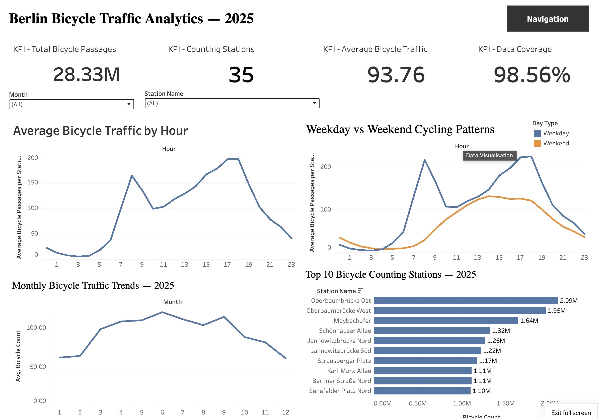
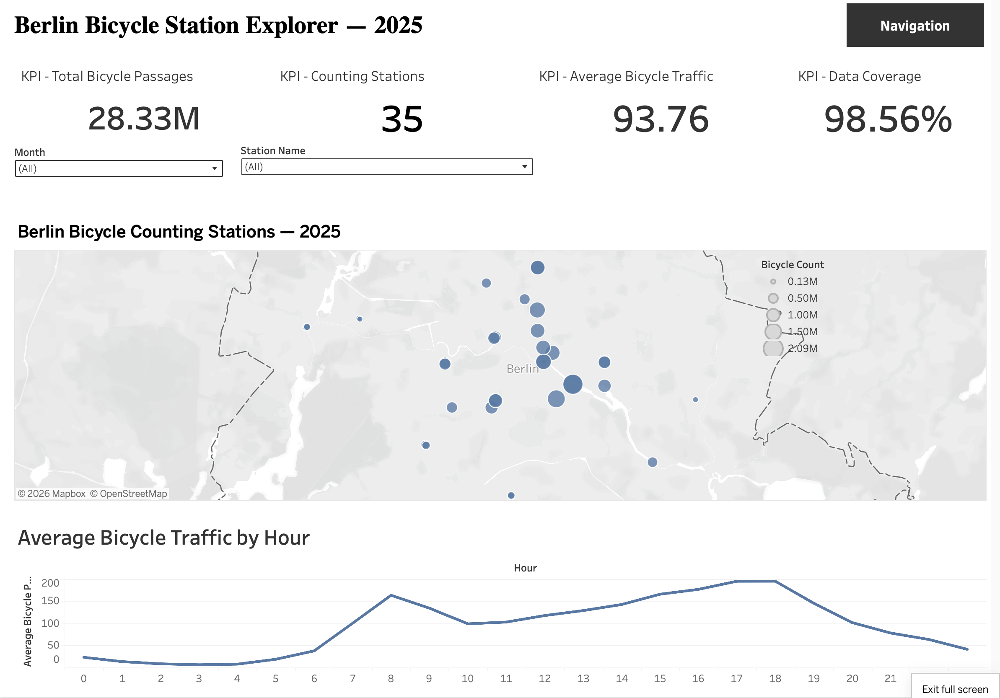

# Berlin Bicycle Traffic Analytics | 2025

**End-to-End Data Analytics Project · Python · Pandas · MySQL · Tableau**

An analysis of Berlin's official automated bicycle-counting data for 2025. The project turns hourly observations into a cleaned relational dataset, analyzes cycling patterns using SQL, and presents the results in two interactive Tableau dashboards.

### [Explore the Interactive Tableau Dashboards](https://public.tableau.com/views/BerlinBicycleTrafficAnalytics-2025/01-TrafficOverview)

## Dashboard Preview

### 1. Traffic Overview



### 2. Station Explorer



Use the navigation buttons within the published Tableau workbook to switch between these views.

## Project Objectives

- Analyze how bicycle traffic changes throughout the day.
- Compare weekday and weekend cycling patterns.
- Identify the busiest counting stations.
- Examine monthly and seasonal variation.
- Enable interactive exploration of individual station locations.

## Technology Stack

| Technology | Purpose |
|---|---|
| Python, Pandas | Cleaning, transformation, and ETL |
| Jupyter Notebook | Data exploration and quality checks |
| MySQL | Relational storage and SQL analysis |
| SQLAlchemy, PyMySQL | Python-to-MySQL connection |
| Tableau Public | Interactive visualizations and dashboards |
| GitHub | Project documentation and code sharing |

## Data Summary

The project uses Berlin's official bicycle counting Excel workbook, focusing on the `Jahresdatei 2025` and `Standortdaten` sheets.

| Measure | Value |
|---|---:|
| Year | 2025 |
| Hourly timestamps | 8,760 |
| Counting stations | 35 |
| Station-hour records | 306,600 |
| Missing bicycle counts | 4,426 |
| Valid observation coverage | 98.56% |

**Interpretation:** Counts describe bicycle *passages* at specific counting locations, not unique riders or all bicycle trips in Berlin.

## Data Preparation and Analysis

1. Loaded the 2025 hourly Excel sheet and station metadata with Pandas.
2. Checked missing counts, duplicate timestamps, and negative values.
3. Standardized station column names and transformed wide-format counts into long-format station-hour records.
4. Reconciled two inconsistent station ID pairs between the traffic and metadata sheets.
5. Merged geographic metadata and confirmed that all 306,600 station-hour records matched a station.
6. Engineered year, month, day, hour, weekday, weekend, and season variables.
7. Exported cleaned `stations` and `bicycle_counts` tables and loaded them into MySQL.
8. Used SQL to analyze traffic patterns and define the `vw_bicycle_traffic` Tableau export view.
9. Developed the Traffic Overview and Station Explorer dashboards in Tableau Public.

## Key Findings

- **28,332,132 recorded bicycle passages** across the 35 stations in 2025.
- **93.76 passages per valid station-hour** on average.
- Average hourly traffic peaks around **18:00**, with another prominent peak around **08:00**.
- Weekday station-hour averages (**105.27**) exceed weekend averages (**64.86**).
- **Oberbaumbrücke Ost** is the highest-recorded station, with approximately **2.09 million passages**.
- In the 32-station high-coverage subset, **June** shows the highest monthly average (**122.29 passages per valid station-hour**).

## Dashboard Features

**01 — Traffic Overview:** KPIs, hourly patterns, weekday/weekend comparison, monthly trends, and Top 10 station rankings. Month and station dropdowns support focused analysis.

**02 — Station Explorer:** Interactive station map with marker sizes showing recorded passages. Selecting a station updates its KPIs and hourly traffic profile.

**[Open Tableau Public dashboard](https://public.tableau.com/views/BerlinBicycleTrafficAnalytics-2025/01-TrafficOverview)**

## Data Quality and Limitations

- Missing observations remain missing (`NaN` / SQL `NULL`), **not zero**.
- The overall coverage figure is calculated from available station-hour observations, not inferred activity.
- The monthly trend chart uses **32 stations with at least 99% annual coverage**; three stations with greater missingness are excluded from that chart only.
- Most other dashboard metrics include all **35 stations**, so the monthly subset is not directly identical to the full-network aggregation.
- Totals are **recorded passages** and do not estimate activity during missing observations or count unique cyclists.
- Counts are limited to instrumented stations and should not be interpreted as Berlin-wide trip totals.

## Repository Structure

```text
berlin-bicycle-traffic-analytics/
├── notebooks/
│   └── 01-data-exploration-github-ready.ipynb
├── sql/
│   ├── 01_exploratory_analysis.sql
│   └── 02_dashboard_views.sql
├── dashboard/
│   ├── traffic_overview.png
│   └── station_explorer.png
└── README.md
```

## Reproducibility

The notebook documents the transformation pipeline. To rerun it, place the source Excel workbook under `data/raw/`, install the Python dependencies (`pandas`, `matplotlib`, `openpyxl`, `sqlalchemy`, `pymysql`), and configure a local MySQL database named `berlin_bicycle_analytics` with the expected schema. Run the view-creation SQL before exporting the Tableau dataset.

The notebook prompts for database credentials rather than storing passwords in code. The database import uses append mode, so rerunning the loading cells against populated tables requires care to avoid duplicate data or primary-key errors.

---

*Portfolio project: Python data cleaning, SQL analytics, data-quality assessment, and interactive Tableau reporting.*
